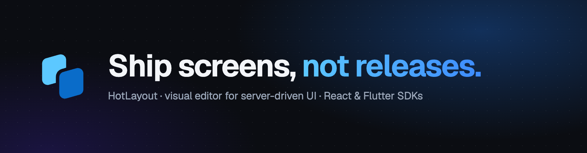
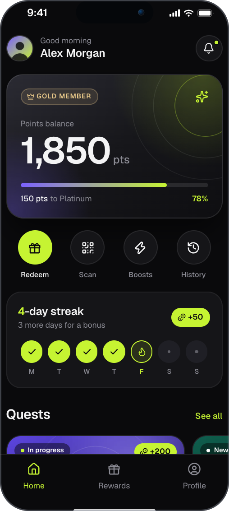
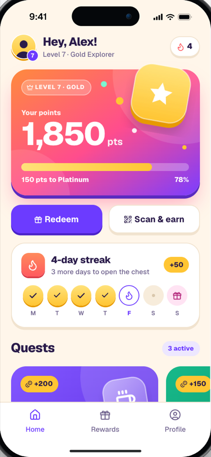

<p align="center">
  <a href="https://hotlayout.com"></a>
</p>

**HotLayout** is a visual editor for server-driven UI. A product team builds an app screen in the editor and publishes it; the app shows the new screen the next time it loads — no build, no store review, no release.

<p align="center">
  
  &nbsp;&nbsp;&nbsp;
  
</p>
<p align="center"><sub>Two apps built in the same editor. Both are published documents drawn by the SDK — try them live at <a href="https://hotlayout.com">hotlayout.com</a>.</sub></p>

<p align="center"><a href="https://www.youtube.com/watch?v=VuBn65spggU"><b>▶ Watch the product overview</b></a> — the whole flow in under two minutes.</p>

## How it works

1. **Build.** Screens are assembled from widgets in a visual editor: layout, text, lists from data, forms, navigation, translations, a theme with your brand tokens.
2. **Publish.** The screen becomes a JSON document. It is delivered from our storage or by a signed webhook to your own backend.
3. **Render.** Your app draws the document natively with an open-source SDK. Every tap arrives in your code, and your users' data never passes through us.

## SDKs

| Platform | Package | Source |
|---|---|---|
| React (web, Next.js) | [`@hotlayout/react`](https://www.npmjs.com/package/@hotlayout/react) &nbsp; [](https://www.npmjs.com/package/@hotlayout/react) | [hotlayout-react](https://github.com/hotlayout/hotlayout-react) |
| Flutter (iOS, Android) | [`hotlayout_flutter`](https://pub.dev/packages/hotlayout_flutter) &nbsp; [](https://pub.dev/packages/hotlayout_flutter) | [hotlayout-flutter](https://github.com/hotlayout/hotlayout-flutter) |

Both SDKs are open source under Apache 2.0 and read the same document: one screen, built once, drawn on every platform.

```tsx
import { HotlayoutScreen } from '@hotlayout/react'

<HotlayoutScreen
  document={layout} // the layout document, parsed JSON
  theme={theme} // the project theme, parsed JSON
  data={{ 'user.firstName': 'Ada', 'user.points': 1250 }}
  locale="en"
  onAction={(action, source) => {
    console.log('the user asked for', action.type, action.params, 'on', source.nodeId)
  }}
/>
```

## Links

- **Website** — [hotlayout.com](https://hotlayout.com)
- **Video** — [product overview](https://www.youtube.com/watch?v=VuBn65spggU) and more on the [YouTube channel](https://www.youtube.com/@hotlayoutapp)
- **Documentation** — [hotlayout.com/docs](https://hotlayout.com/docs): integration guides for developers and a user guide for the editor
- **Contact** — [contact@hotlayout.com](mailto:contact@hotlayout.com)
